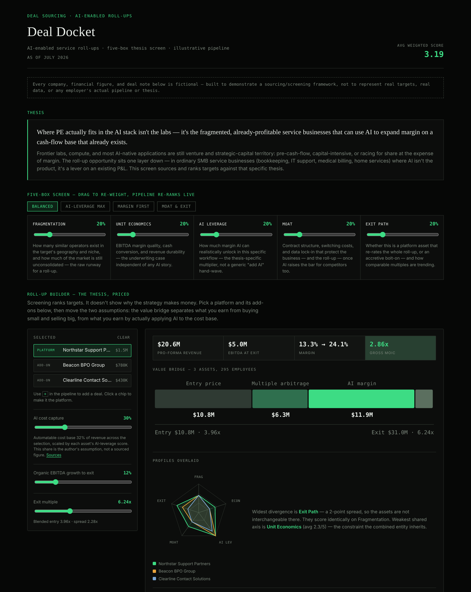

# Deal Docket — AI-Enabled Roll-Up Dashboard

A deal-sourcing and screening dashboard built around a specific, opinionated thesis: PE doesn't play well at the AI labs/compute layer — it plays in the fragmented, already-profitable SMB service businesses (bookkeeping, IT support, medical billing, home services) where AI is a margin lever on an existing cash-flow base, not the product itself.

**All data is fictional.** Every company, financial figure, and deal note is solely illustrative — built to demonstrate a sourcing/screening framework end-to-end, not to represent real targets.

**Live:** https://bakulbadwal.github.io/dealdocket/



**Open it:** clone the repo and run a local static server (see below) — the app fetches `data.json`, which browsers block over `file://`.

## What's inside

**Screening**

- **The five-box screen** — five weighted criteria (market fragmentation, unit economics, AI-adoption leverage, moat & stickiness, exit path), each with a live slider. Drag any weight and the entire 30-deal pipeline re-ranks in real time — the point is to make the thesis's sensitivity to its own assumptions visible, not just show a static scorecard.
- **Weight presets** — one-click lens switches (Balanced, AI-Leverage Max, Margin First, Moat & Exit) that jump all five sliders at once; any manual drag hands control back to you.
- **Rank stability** — the sharp question about any weighted score is which results survive a change of mind. Every deal is ranked across **2,000 weightings sampled uniformly from the simplex**, and the drawer reports its best/median/worst rank, its p10–p90 band, and the share of weightings where it lands top-five. A narrow band means the deal is genuinely strong; a wide one means its rank is an artefact of how you happen to be weighting today. Seeded, so the figures are identical on every load.
- **A 30-deal illustrative pipeline** across 10 service verticals, spanning every stage from sourced to closed to passed — including deals that fail the screen, not just wins.

**Modelling the thesis**

- **The roll-up builder** — screening ranks targets but never shows why the strategy makes money. Pick a platform and its add-ons and the tool models the combination: pro-forma revenue, EBITDA, margin and headcount; the blended entry multiple; and a **value bridge that separates the two real sources of return** — multiple arbitrage (buy sub-scale, exit at the platform multiple, no operating change) from AI margin expansion (each vertical's automatable cost base × how much you capture × that asset's own AI-leverage score). The bridge is constructed to close exactly: `entry + arbitrage + AI + organic === exit value`.
- **Overlaid profiles** — the radars of every selected asset drawn on one chart, answering the question you actually have while assembling a roll-up: are these the same shape, or complementary? A roll-up of identical profiles concentrates the same risk.
- **Live assumptions** — AI cost capture, organic growth and exit multiple are all sliders, and the tool states its own limitations next to the output (all-equity, pre-fee, no integration cost, no failed add-on).

**Using it**

- **Shareable state** — weights, filters, sort and the entire roll-up selection are encoded in the URL, so a link reproduces a *specific reading* rather than the default view. Mirrored to `localStorage`, so returning to the page restores your last calibration.
- **Deal detail drawer** — per-criterion rationale, financials, ask and entry multiple, headcount, recurring-revenue share, and the rank-stability band.
- **Filters and live stats** — search, vertical/stage/channel filters, active-pipeline-only toggle, and a stats bar.
- **Keyboard accessible** — every deal is a real focusable control, the drawer is a proper dialog with focus trapping and return, and there's a visible focus ring throughout.

The visual language is deliberately terminal-inspired — monospace numerals, hairline rules, a single green accent that carries meaning (high scores and healthy stages) rather than decoration.

## Reading further

- **[CASE_STUDY.md](./CASE_STUDY.md)** — the product write-up: the problem being modelled, who it's for, the decisions and tradeoffs, and how I'd measure whether it works.
- **[ROADMAP.md](./ROADMAP.md)** — what this doesn't do yet and why, including the honest weak spot (the automatable-cost estimates driving the AI uplift are mine, not researched — and are tagged as such in the data), plus what's deliberately *not* being built.

## A note on the numbers

Financials are stored as numbers, not display strings, so every figure on the page is computed rather than written down. Entry multiples are a deterministic function of deal size and the moat/exit-path scores — reproducible, not random. The margin is derived from revenue and EBITDA at render time so it cannot drift out of sync with them.

The one input that is *not* derived is `automatableCostShare` per vertical, which drives the AI uplift. Those are estimates, marked `"basis": "estimate"` in `data.json` with a null source. See the roadmap.

## Architecture

Same data/view split as [the AI Stack](https://github.com/bakulbadwal/aistack): `data.json` holds every deal, the framework definition, and the thesis copy; `app.js` renders it and runs the scoring engine; `styles.css` handles presentation. A sourcing pipeline is exactly the kind of content that should be able to update independently of the render logic.

## Running locally

```
git clone https://github.com/bakulbadwal/dealdocket.git
cd dealdocket
python3 -m http.server 8000
```

Then open `http://localhost:8000/`.

## Stack

Vanilla HTML/CSS/JS. No framework, no build step, no dependencies.

## License

MIT — see [LICENSE](LICENSE).
